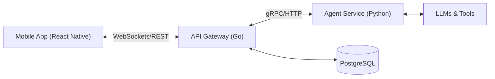

# Genie

<div align="center">

**A powerful AI Agent ecosystem connecting mobile, backend, and autonomous agents.**

[](api/)
[](back/)
[](front/)
[](LICENSE)

</div>

---

## 📖 Overview

**Genie** is a comprehensive system designed to bridge the gap between user-facing mobile applications and complex autonomous AI agents. It features a high-performance Go API, a flexible Python-based agent orchestration layer using the [Agno](https://github.com/agno-agi/agno) framework, and a polished React Native mobile interface.

### Key Features

- 📱 **Mobile First**: Native iOS and Android experience built with React Native and TypeScript, featuring a polished UI.
- 🧠 **Autonomous Agents**: Intelligent agent teams powered by Python and the Agno framework, capable of complex reasoning and tool use.
- ⚡ **High Performance API**: Robust REST and WebSocket API built with Go, Gin, and GORM for real-time communication.
- 🔌 **Plugin System**: Modular architecture allowing easy extension of capabilities (Gmail, Calendar, GitHub, etc.).

---

## 🏗 Architecture

The system consists of three main components that interact seamlessly:



## 🛠 Tech Stack

| Component | Technology | Description |
|-----------|------------|-------------|
| **Frontend** | React Native, TypeScript, Expo | Cross-platform mobile application utilizing React Context for state management. |
| **Backend (AI)** | Python, Agno, FastAPI | Agent orchestration service handling AI logic, tools, and team coordination. |
| **API** | Go, Gin, GORM | High-performance API server managing users, chat history, and real-time events. |
| **Database** | PostgreSQL | Relational database for persistent storage (users, chats, logs). |
| **Infrastructure** | Docker, Railway | Containerized deployment and CI/CD pipelines. |

---

## 🚀 Getting Started

### Prerequisites

- **Docker** & **Docker Compose**
- **Go** 1.22+
- **Python** 3.11+
- **Node.js** 20+

### Installation

1. **Clone the repository**
   ```bash
   git clone https://github.com/kliuchnikovv/genie-api.git
   cd genie-api
   ```

2. **Initialize the Environment**
   Run the following commands to set up dependencies for all services:

   ```bash
   # api setup
   cd api && go mod download

   # agent setup
   cd ../back
   python3 -m venv .venv
   source .venv/bin/activate
   pip install -r requirements.txt

   # mobile setup
   cd ../front
   npm install
   ```

3. **Start Services (Docker)**
   
   To run the backend services (API, Agent, DB) using Docker Compose:
   ```bash
   docker-compose up --build
   ```

---

## 💻 Development

This section provides commands to run each service individually for development purposes. For coding standards and contribution guidelines, please see [AGENTS.md](AGENTS.md).

### Mobile App ([`front/`](./front/))
```bash
cd front
npm start
# Press 'i' for iOS simulator or 'a' for Android emulator
```

### API Server ([`api/`](./api/))
```bash
cd api
go run cmd/api/main.go
```

### Agent Service ([`back/`](./back/))
```bash
cd back
source .venv/bin/activate
python app.py
```

---

## 🤝 Contributing

We welcome contributions! Please read our [AGENTS.md](AGENTS.md) for:
- 📏 **Coding Rules** (Global & Component-specific)
- 🧪 **Testing Commands**
- 🚫 **Forbidden Actions**

---

## 📄 License

This project is licensed under the MIT License - see the [LICENSE](LICENSE) file for details.
